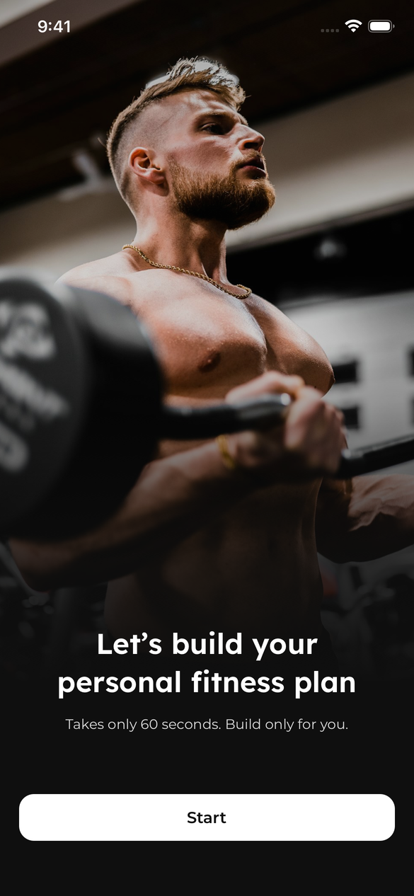
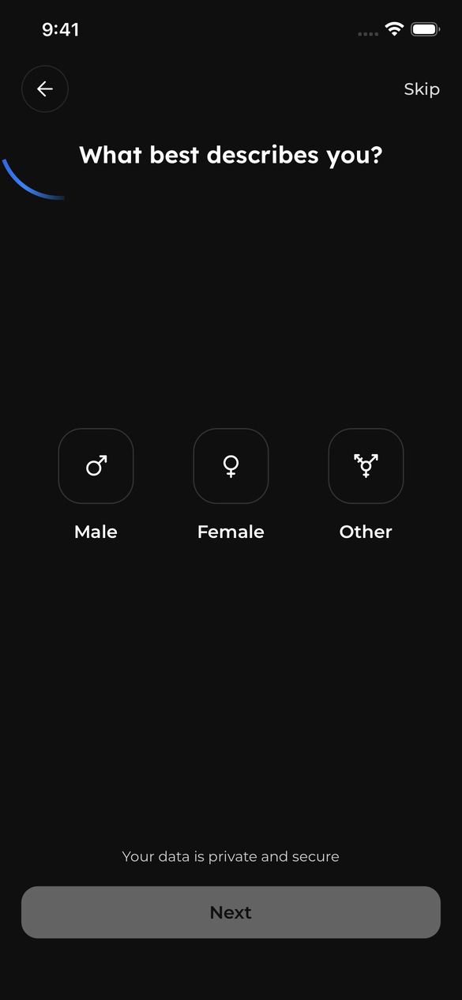
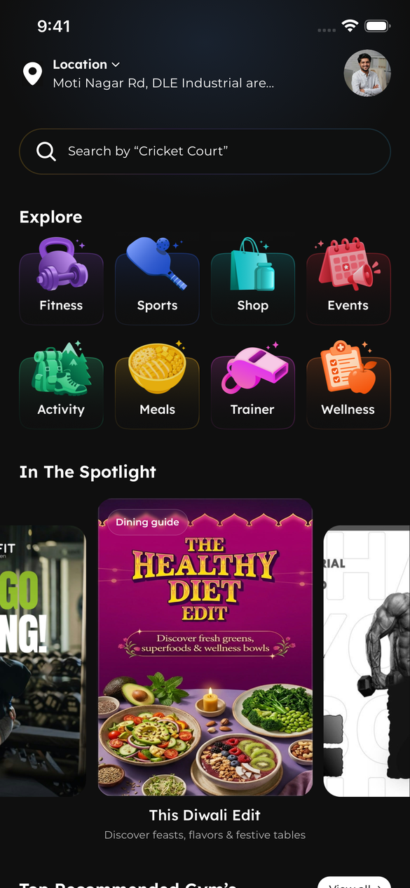
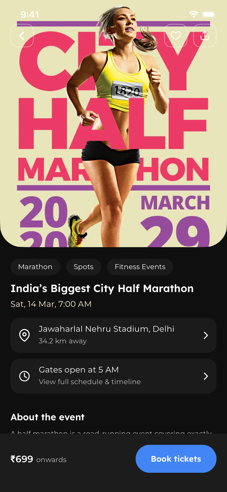
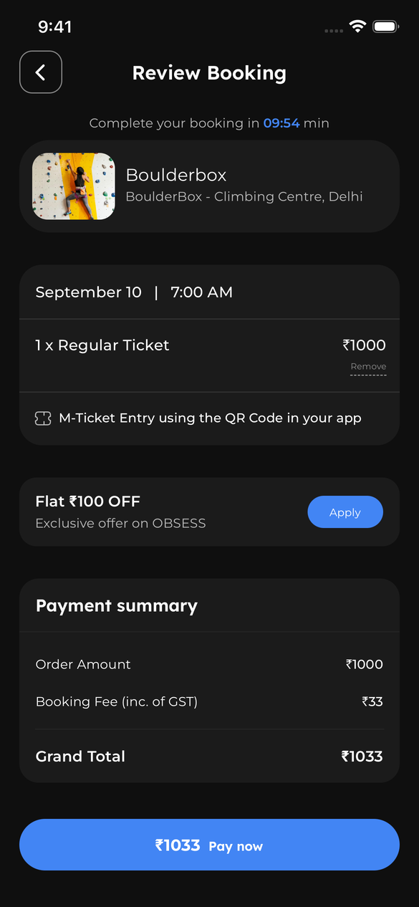
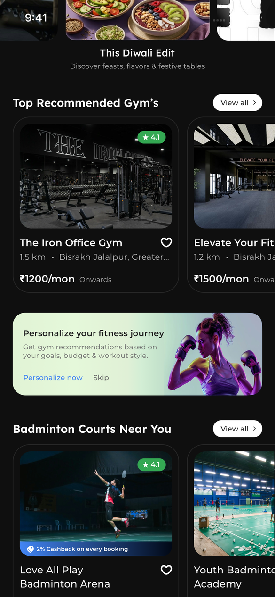
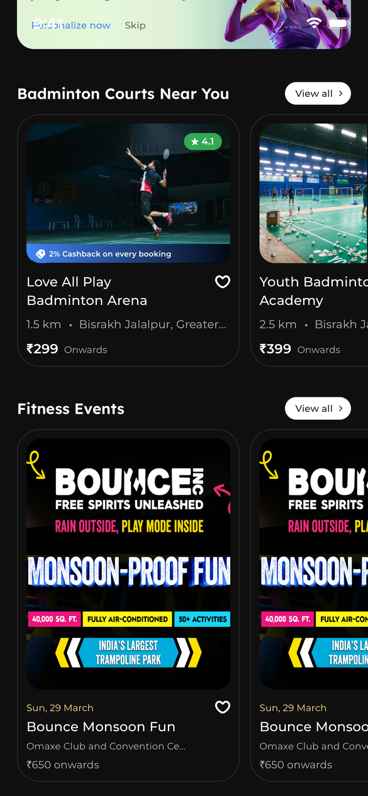
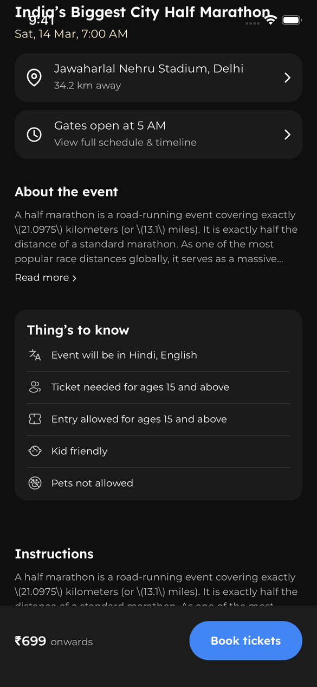
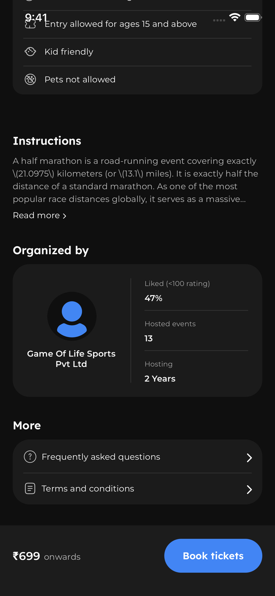
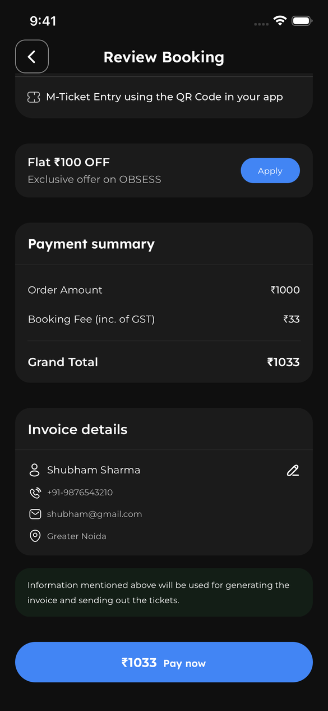

# Fitness App — React Native UI & Animation

Bare React Native CLI app (RN 0.88, New Architecture, Hermes). Mock data only.

## Screenshots

| Welcome | Onboarding | Home | Event details | Review booking |
|:-:|:-:|:-:|:-:|:-:|
|  |  |  |  |  |

<details>
<summary>More screens</summary>

| Home — gyms & courts | Home — events | Event — info | Event — organizer | Booking — invoice |
|:-:|:-:|:-:|:-:|:-:|
|  |  |  |  |  |

</details>

Screenshots are from the iOS simulator (iPhone 16e, 390 × 844 pt).

## Run

```sh
npm install
npx react-native start
npx react-native run-android   # or run-ios
```

Release APK: `cd android && ./gradlew assembleRelease` → `android/app/build/outputs/apk/release/app-release.apk`
(signed with the debug keystore — fine for sideloading, generate your own keystore for the Play Store).

Deep links: `fitapp-rn://home`, `fitapp-rn://event/<id>`, `fitapp-rn://booking/<kind>/<id>`.

## What's in it

**Onboarding (10 steps, one screen)**: gender → age → weight → height → goal → target weight → timeline → activity → experience → training days → "Personalizing" → Home.
Steps slide in the direction you move (Next/Skip/Back and the Android back button). The blue corner arc grows as you progress, and list rows enter one after another.

**Weight dial** ([src/components/scales.tsx](src/components/scales.tsx)): 341 ticks, 1° each (0.5 kg or 1 lb per tick). Dragging maps the finger's *angle* around the dial centre to rotation, so the dial turns in a circle under a fixed pointer. On release, the angular velocity is projected a short time ahead and a spring carries it into the nearest detent. Touching a moving dial stops it. A slower outer ring adds parallax.

**Height ruler**: the same physics engine (`useTickScale`) driven by vertical pan, in cm or ft/in.

**Age wheel**: three native snapping ScrollViews with distance fade, haptics per row and invalid-day clamping.

**Home** ([src/screens/Home.tsx](src/screens/Home.tsx)): location header, search, Explore grid, a spotlight carousel that scales the side cards, gym / court / event rails with rating, cashback and save, and a dismissible personalization banner.

**Event details** ([src/screens/EventDetails.tsx](src/screens/EventDetails.tsx)): hero, tags, venue and schedule cards, About and Instructions clamped at a word boundary with Read more, Things to know, organizer stats, FAQ / terms and a sticky Book tickets bar.

**Review booking** ([src/screens/Booking.tsx](src/screens/Booking.tsx)): 10-minute hold countdown, ticket remove / add, coupon apply, live payment summary (order + 3.3% fee − coupon), invoice details and an animated confirmation.

Every tappable element springs on press and gives a light haptic.

## Design fidelity

The Home, Event details and Review booking screens are built from the 4× design exports in [design/refs](design/refs).

- **Measurements:** text sizes, line boxes and baselines were solved from font metrics against the exports.
- **Typography:** Montserrat uses a measured 0.0085 em tracking to match the exports.
- **Artwork:** lives in [src/assets/design](src/assets/design) at its exact design size.

`scripts/visual-diff.py` launches each screen on a 390 pt simulator and compares it with the exports at several scroll positions. It writes design | app | heat-map images to `design/diff/` and fails above 3% mismatch.

```sh
UDID=<simulator-udid> python3 scripts/visual-diff.py      # needs Metro running and ffmpeg
```

## Tests

```sh
npx jest
```

The suite has 105 tests:

- **Screens:** content, design tokens, geometry and interactions for Home, Event details and Booking.
- **Pricing and timer:** quote math and hold-countdown formatting.
- **Route adapters:** every event, gym and court route resolves.
- **Assets:** every design asset is a whole-point 4× export.
- **Fonts:** each font's internal name matches its file name, and every theme font is registered on iOS and Android.

## Stack

`react-native-reanimated` 4 · `react-native-gesture-handler` 3 · `react-native-svg` · `@react-navigation/native-stack` · `react-native-haptic-feedback` · `lucide-react-native` · Lexend + Montserrat fonts.
